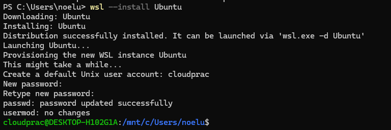
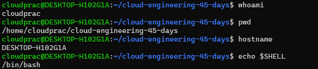
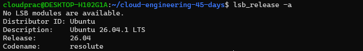
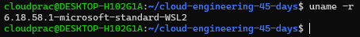
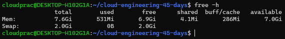
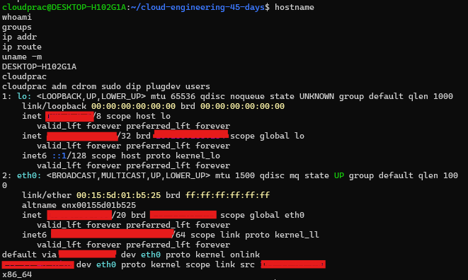

# Day 01 – Linux, Ubuntu and WSL Setup

## Project Overview

This project documents the installation and configuration of an Ubuntu Linux environment using Windows Subsystem for Linux (WSL 2).

The objective was to establish a Linux development environment for cloud engineering, DevOps and infrastructure administration.

## Learning Objectives

- Understand Linux fundamentals and Ubuntu architecture.
- Install Ubuntu using WSL 2.
- Access and navigate the Linux terminal.
- Identify operating system and kernel versions.
- Inspect CPU, RAM and disk specifications.
- Understand basic Linux system configuration.
- Execute basic Linux administration commands.

## 1. Environment Details

| Component | Details |
|---|---|
| Host Operating System | Version 25h2 (OS Build 26200.9974) |
| Linux Distribution | Ubuntu |
| Ubuntu Version | Ubuntu 26.04.1 LTS |
| WSL Version | WSL 2 |
| Kernel Version | 6.18.58.1-microsoft-standard-WSL2 |
| Architecture | x86_64 |
| Shell | Bash |
| Terminal | Windows Terminal / Ubuntu |
| Linux Username | cloudprac |

## 2. Ubuntu Installation

Ubuntu was installed using Windows Subsystem for Linux.

### Installation Command

```powershell
wsl --install -d Ubuntu
```

### Installation Verification

```powershell
wsl --list --verbose
```

### Installation Evidence



## 3. Terminal Access

Ubuntu was launched through the Windows Terminal application.

Commands used:

```bash
whoami
pwd
hostname
echo $SHELL
```

### Terminal Evidence



## 4. Ubuntu Version

Command:

```bash
lsb_release -a
```

**Actual result:**


## 5. Linux Kernel Information

Command:

```bash
uname -r
```

**Actual result:**


## 6. CPU Information

Command:

```bash
lscpu
```

Document:

- Architecture: x86_64
- CPU count: 6
- CPU vendor: GenuineIntel
- Core information: Model name: 12th Gen Intel(R) Core(TM) i5-1235U Model: 6 Threads(s) per core: 2 Cores(s) per socket: 2 	


## 7. RAM Information

Command:

```bash
free -h
```

**Actual result:**


## 8. Disk Information

Command:

```bash
df -hT
```

Document:

- Filesystem: ext4
- Total size: 1007G
- Used space: 1.3G
- Available space: 955G

## 9. Basic System Configuration

Commands executed:

```bash
hostname
whoami
groups
ip addr
ip route
uname -m
```

### Configuration Evidence



## 10. Ubuntu Package Updates

Commands executed:

```bash
sudo apt update
sudo apt upgrade -y
```

Basic tools installed:

```bash
sudo apt install -y curl wget git tree
```

Verification:

```bash
git --version
curl --version
wget --version
tree --version
```

## 11. Key Linux Commands Learned

| Command | Description |
|---|---|
| pwd | Display current directory |
| ls | List files and directories |
| cd | Change directory |
| mkdir | Create directories |
| touch | Create empty files |
| cat | Display file contents |
| whoami | Identify current user |
| uname | Display kernel information |
| lscpu | Display CPU information |
| free -h | Display memory information |
| df -h | Display filesystem usage |
| ip addr | Display network interfaces |
| sudo | Execute privileged commands |

## 12. Challenges and Troubleshooting

Document any problems encountered during installation or configuration.

- Problem: N/A
- Cause: N/A
- Solution: N/A

## 13. Key Learnings

- Understood the relationship between Linux and Ubuntu.
- Learned the basic architecture of Ubuntu.
- Installed Ubuntu using WSL 2.
- Practiced Linux terminal commands.
- Collected system hardware and software information.
- Learned basic package management using APT.

## 14. Future Applications

These Linux fundamentals will be used in upcoming cloud engineering exercises involving Linux administration, AWS EC2, networking, automation and DevOps.

---

**Training Program:** Cloud Engineering – 45 Days  
**Module:** Linux Fundamentals  
**Day:** 01  
**Status:** [Completed]
